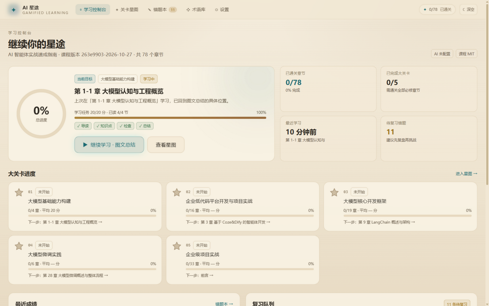
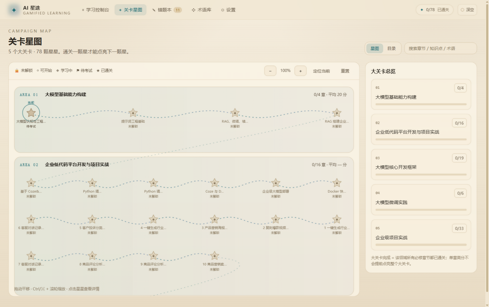
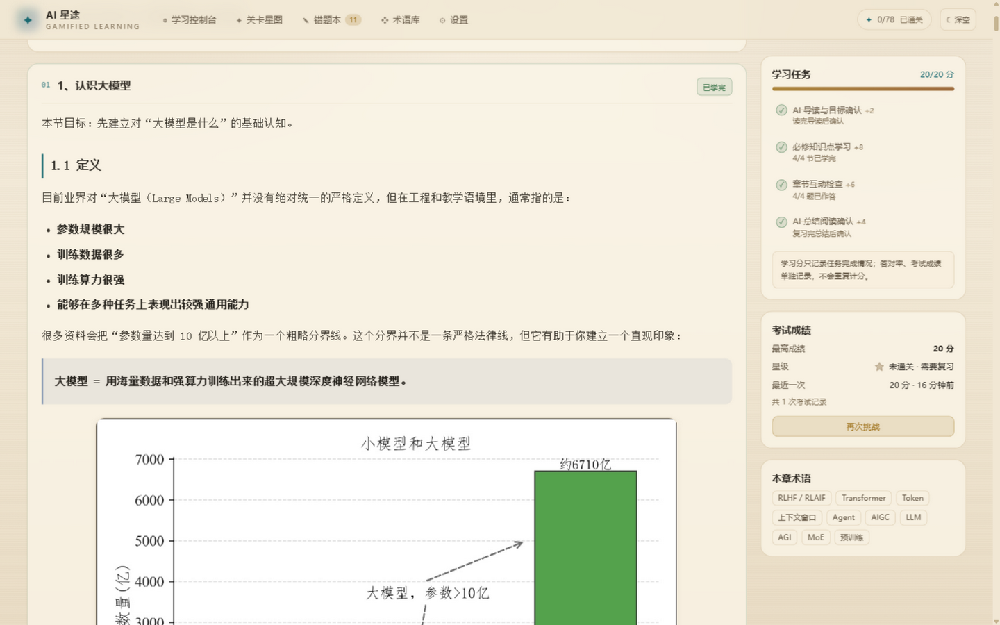
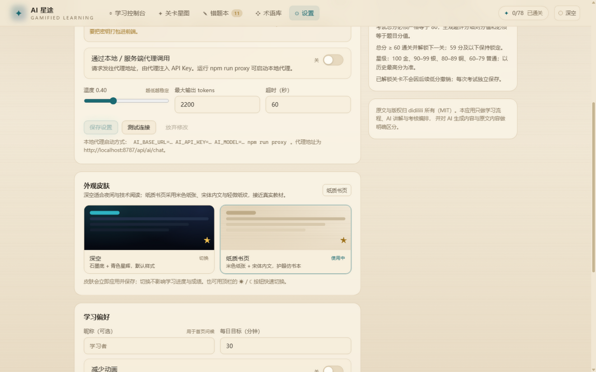

# AI 星途 · 游戏化智能学习系统

以《AI 智能体实战速成指南》（[ai-agents-from-zero](https://github.com/didilili/ai-agents-from-zero)，MIT）真实课程内容为底座，把 78 个章节组织成 5 个大关卡的 RPG 星图。学习流程完整闭环：

**AI 导读 → 逐节讲解 + 互动检查 → 图文总结 → 80 分章节考试 → 星级评价 → 解锁下一关 → 错题本复习**

本地优先：进度、成绩、错题、笔记、AI 缓存全部存在浏览器 IndexedDB；未配置模型时仍可完整学习、考试、评分和复习。

**仓库地址**：<https://github.com/zzr767299/ai_xingtu>

## 界面预览

| 学习控制台 | 关卡星图 |
| --- | --- |
|  |  |
| **章节学习（纸质书页皮肤）** | **设置与 AI 配置** |
|  |  |

> 截图使用「纸质书页」皮肤；可在设置或顶栏一键切换回「深空」深色皮肤。

---

## 1. 快速开始

```bash
git clone https://github.com/zzr767299/ai_xingtu.git
cd ai_xingtu
npm install

npm run dev        # 开发服务器，默认 http://localhost:5173
npm test           # 53 项自动化测试
npm run build      # 类型检查 + 生产构建（dist/）
npm run preview    # 预览生产构建
```

仓库已包含解析后的课程数据（`public/course/`，78 章），克隆后无需课程仓库即可直接运行。

如果需要修改课程原文并重新解析，或复制课程图片：

```bash
# 默认读取同级的 ../ai-agents-from-zero 仓库
COURSE_REPO="/path/to/ai-agents-from-zero" npm run course:build
npm run course:assets   # 可选：复制图片素材
```

> 若 5173 被占用：`npm run dev -- --port 5180 --host 127.0.0.1`。

### 图片加载

仓库不包含约 515MB 的课程图片，页面会按以下顺序加载：

1. 本地 `public/course-assets/...`（运行过 `npm run course:assets` 时存在）；
2. 自动回源到上游课程仓库的 GitHub raw（需要能访问 `raw.githubusercontent.com`）；
3. 两者都不可用时显示占位说明，不影响正文、考试与进度。

从 GitHub clone 后联网即可看到图片，无需重新上传素材。若要离线使用或完全本地化：

```bash
# 需要同级的 ai-agents-from-zero 课程仓库
npm run course:assets   # 复制约 515MB 图片到 public/course-assets/
```

开发与 `vite preview` 还内置了 `/course-assets/` 中间件，会直接读取课程仓库图片作为补充。

### 环境要求

- Node.js ≥ 20（开发使用 Node 24）
- 直接运行不需要课程仓库；只有执行 `npm run course:build` / `npm run course:assets` 时需要：
  - 默认读取同级的 `../ai-agents-from-zero`；
  - 或用 `COURSE_REPO="/path/to/any-course-repo" npm run course:build` 指定任意 docsify 风格课程仓库。

课程仓库需包含 docsify 风格的 `_sidebar.md` 与章节 Markdown；解析器支持 H1/H2/H3、列表、表格、代码块、图片、引用、`<details>` 与相对链接。

---

## 2. 功能清单

### 已实现

| 模块 | 内容 |
| --- | --- |
| 课程数据 | 5 大关卡 / 78 章节 / 184 条术语 / 24 组易混对照；18,768 个内容块从 Markdown 解析为 JSON；链接改写为站内路由，源码链接指向 GitHub；图片本地优先、缺失自动回源上游 |
| 学习控制台 | 总进度、通关章节、已完成大关卡、当前章节、最近学习时间、继续学习（恢复到具体章节 + 知识点 + 标签页）、复习队列、最近成绩、收藏的总结 |
| 关卡星图 | 5 条领域泳道、78 颗星、蛇形路线、可拖动/缩放/定位；每个大关卡首章默认开放，可自由选择领域，同一领域内按顺序解锁；未解锁/可开始/学习中/待考试/已通关五态（图标 + 文字 + 形状，不只靠颜色）；节点详情弹窗；普通目录视图 + 搜索/筛选 |
| 导读 | 学习价值、目标（优先取原文「本章课程目标」）、核心概念、前置知识、推荐顺序、预计时长、考试计划；确认后 +2 学习分 |
| 讲解 | 按 H2 知识点分块阅读，代码块复制、图片、表格、原文链接；每节可标记已学完；每节插入 1 道互动检查（答错给解析和回跳入口）；阅读位置自动保存；章节笔记 |
| AI 助手 | 基于当前章节 + 当前知识点上下文对话；6 个快捷提问；对话按章节持久化；失败明确提示，不伪造结果 |
| 逐节精讲 | 配置模型后可按节生成结构化讲解（是什么/解决什么问题/何时使用/易混关系/案例/常见错误），结果缓存；未配置时明确显示「未配置」 |
| 图文总结 | 核心知识点、知识结构图、术语卡、易混对比、关键代码、应用场景、常见错误、高频考点、自测清单；收藏、复制、重新生成；确认后 +4 学习分 |
| 考试 | 三种题型模板（概念/综合/工程实战），严格 80 分；11–13 题；选择/填空自动判分；主观题 AI 按评分细则阅卷，或本地关键词估分；提交前可修改，未答题提示；草稿可刷新恢复 |
| 游戏规则 | 学习分 20（2/8/6/4）+ 考试 80；总分 100；60 通关；金/银/铜/普通星级；顺序解锁；最高分决定星级；低分不撤销已解锁关卡；历史成绩与错题完整保存 |
| 错题本 | 按章节/题型/状态筛选、搜索；原答案、参考答案、评分反馈、评分细则、命中/遗漏点；重新作答（满分自动标记已掌握）；AI 同类新题（未配置时用本地同类练习） |
| 数据 | 自动保存（防抖 + 页面隐藏/关闭时 flush）；JSON 导出（默认不含 API Key）；导入前校验 schema/版本、预览数量、选择合并或覆盖；清空数据二次确认 |
| AI 设置 | DeepSeek / 百炼 / OpenAI / Ollama / 自定义；Base URL、模型、Key、温度、max tokens、超时；真实连接测试；代理模式；本地/服务端代理脚本 |
| 皮肤与可用性 | 「深空」与「纸质书页」两套皮肤（米色纸张、宋体内文、轻微纸纹，可顶栏快速切换）；减少动画开关、键盘可达、移动端底部导航、状态不只依赖颜色 |

### 明确的限制（不是假装可用）

- **未配置 AI** 时：导读、总结、题目由本地规则基于原文生成；主观题使用关键词估分，界面会标注「本地生成 / 本地关键词判分」。这不是 AI 生成，也不等同于真实理解评估。
- **AI 精讲、AI 同类新题、AI 阅卷** 必须配置模型；失败时提供重试或显式切换到本地判分，绝不把接口异常记成 0 分自动通关。
- **代码题不会真正执行测试**（无沙箱）；代码补全/阅读题按关键标识符估分，界面明确提示。
- 课程图片约 515MB，不随仓库分发；默认从上游 raw 加载，离线时运行 `npm run course:assets`，否则显示占位说明。
- 第一版没有账号、云同步、跨设备同步、间隔复习算法、成就徽章、阶段总结自动生成；架构预留了扩展位置。

---

## 3. 目录结构

```
ai-xingtu/
├─ scripts/
│  ├─ build-course.mjs        # 解析课程仓库 → public/course/*.json
│  ├─ course-lib.mjs          # 侧边栏/术语表解析、稳定 ID、锚点归一化
│  ├─ copy-assets.mjs         # 可选：复制课程图片到 public/course-assets
│  └─ course-lib.d.mts        # 脚本类型声明（测试使用）
├─ public/course/
│  ├─ course.json             # 课程总表（大关卡、章节元数据、目标、术语、版本）
│  ├─ glossary.json           # 术语与易混对照
│  └─ chapters/<id>.json      # 每章正文块（按知识点切分，懒加载）
├─ server/ai-proxy.mjs        # 可选 AI 代理（Key 留在服务端）
├─ src/
│  ├─ lib/
│  │  ├─ course/loader.ts     # 课程 JSON 加载与缓存
│  │  ├─ domain/rules.ts      # 学习分、星级、通关、解锁、继续学习、合并/同步
│  │  ├─ domain/exam.ts       # 80 分模板、校验、自动判分、本地评分
│  │  ├─ domain/localContent.ts # 本地导读/总结/检查题/题库
│  │  ├─ ai/provider.ts       # OpenAI 兼容请求、超时、重试、错误分类
│  │  ├─ ai/service.ts        # 导读/总结/命题/阅卷/精讲/同类题 + 缓存
│  │  ├─ ai/prompts.ts        # 受章节原文约束的提示词
│  │  ├─ ai/schemas.ts        # Zod 结构化输出校验
│  │  └─ storage/             # IndexedDB / 内存存储、仓储、导入校验
│  ├─ state/AppContext.tsx    # 全局课程、进度、设置、AI 服务
│  ├─ components/             # 布局、星图、Markdown、UI 基元
│  └─ pages/                  # 控制台、星图、章节（导读/讲解/总结/考试）、错题本、术语库、设置
├─ tests/                     # 53 项 Vitest 测试
└─ vite.config.ts             # 课程图片中间件、/api 代理
```

---

## 4. AI 配置

### 方式 A：浏览器直连（个人本地使用）

1. 打开「设置 → AI 模型服务」，选择服务商预设。
2. 填 Base URL、模型名、API Key，启用 AI，保存。
3. 点「测试连接」验证；失败会显示具体 HTTP/网络错误。

Key 只保存在当前浏览器的 IndexedDB，不会进入构建产物；导出的备份默认也不包含 Key。

### 方式 B：服务端代理（正式部署推荐）

```bash
cp .env.example .env
# 编辑 .env：AI_BASE_URL / AI_API_KEY / AI_MODEL
npm run proxy
# → http://localhost:8787/api/ai/chat
```

然后在设置中启用「通过本地 / 服务端代理调用」，代理地址填 `http://localhost:8787/api/ai/chat`（或生产环境地址）。前端不再持有 Key。

Ollama 直连需要允许跨域：`OLLAMA_ORIGINS=* ollama serve`。

### 测试连接与常见问题

设置页会显示**实际请求地址**，并提供三个按钮：`测试当前配置`、`测试直连`、`测试代理`。代理开启时，Base URL 与 API Key 不参与请求，由代理服务端注入；界面会用金色提示明确这一点。

- **`✗ 模型服务返回错误（HTTP 500）… 代理未配置 AI_API_KEY`**
  请求走的是代理，但代理服务端没有 Key。复制设置页给出的 `.env` 片段到项目根目录，填入 `AI_API_KEY`，重启 `npm run proxy`；或关闭代理改为直连测试。
- **`✗ 网络请求失败：Failed to fetch`（直连）**
  多数是服务端不允许浏览器跨域，而不是 Key 错误。可先用 `curl` 验证接口本身：
  `curl -i -X OPTIONS "<BaseURL>/chat/completions" -H "Origin: http://127.0.0.1:5180" -H "Access-Control-Request-Method: POST"`。
  若返回 405 或缺少 `Access-Control-Allow-Origin`，浏览器直连一定失败，请改用代理——代理是服务端请求，不受 CORS 限制。
- **401 / invalid_api_key（经代理）**
  Key 本身无效或没有该模型权限；代理转发链路已经通了，只需换有效 Key。

---

## 5. 课程数据与更新

```bash
npm run course:build   # 重新解析 Markdown
npm run course:assets  # 可选：复制图片
```

- **稳定 ID**：`ch_<sha1(源文件相对路径)[:10]>`。改标题、重排章节不影响 ID。
- 每章保存 `contentHash`（原文哈希）与 `sourcePath`。课程版本变化（`course.json.version`）时，启动会用旧映射按「源路径 → 内容哈希」把进度、成绩、错题迁移到新 ID；匹配不到的记录保留为孤儿，不会被错误分配给其他章节。
- AI 缓存键包含 `chapterId + contentHash + feature + model + promptVersion`，原文或模型变化会自动失效。
- 链接重写：`xxx.md` → `#/learn/<chapterId>?s=<知识点>`；案例源码等仓库文件 → GitHub blob/tree 链接。
- 课程正文、术语表、目标全部来自仓库原文；应用不重复存储「课程目录大纲」中的导航信息，避免两套目录不一致。

---

## 6. 评分与解锁（业务规则）

| 项目 | 规则 |
| --- | --- |
| 总分 | 学习 20 + 考试 80 = 100 |
| 学习分 | 导读 2、全部知识点 8、全部检查作答 6、总结确认 4 |
| 学习检查 | 答对率单独记录，不进入学习分，也不重复计入考试 |
| 试卷 | 题型模板固定总分 80；任何题目分值之和 ≠ 80 的试卷拒绝开考 |
| 主观题 | 必须有评分细则；细则关键词分值之和必须等于题目分值 |
| 判分 | 选择精确匹配；填空规范化匹配（大小写/空格/标点/同义）；主观题 AI 或本地关键词 |
| 通关 | 总分 ≥ 60；< 60 不解锁下一关 |
| 星级 | 100 金、90–99 银、80–89 铜、60–79 普通、< 60 未通关 |
| 历史 | 每次考试独立保存；最高分决定星级与通关；重新考试不删除历史 |
| 解锁 | 每个大关卡的首章默认开放，可自由选择想学的领域；同一大关卡内仍需前一章通关；已解锁不因低分撤销 |

规则实现于 `src/lib/domain/rules.ts` 与 `src/lib/domain/exam.ts`，与 UI 解耦并有测试覆盖。

---

## 7. 测试结果

```
Test Files  5 passed (5)
     Tests  53 passed (53)
```

覆盖：

- 学习分 2/8/6/4 与 20 分上限，部分完成不发分；
- 星级边界 100/99/90/89/80/79/60/59；
- 59 不通关、60 通关；不及格不解锁；通关后低分不撤销；
- 试卷总分必须 80；评分细则分值和必须等于题目分值；选择题答案必须在选项中；题目 ID 唯一；
- 填空大小写/空格/同义词；残缺答案不接受；主观题关键词估分；
- 78 个真实章节全部能生成合法 80 分本地试卷；
- 每节检查 4 个不重复选项且答案在选项中；
- 刷新后从 IndexedDB 恢复位置与成绩；重复考试保留历史；
- 导出 → 校验 → 导入；非法格式/版本被拒绝；导出默认不含 Key；
- 课程同步按源路径/内容哈希迁移进度；标题改名或章节重排不丢进度；
- 课程数据完整性：5 大关卡 / 78 章 / 稳定 ID / 无残留 `.md` 链接 / 图片路径正确。

运行：`npm test`。

---

## 8. 已验证的实机流程

在 Chromium（ZCode 内置浏览器）中实际执行并通过：

1. 首页展示真实 78 章进度与控制台数据；
2. 星图渲染 78 个节点，点击可查看详情，锁定章节不可进入；
3. 第一章导读渲染原文目标，确认后学习分 0 → 2；
4. 逐节标记 4 个知识点 + 作答 4 道检查 → 16/20；确认总结 → 20/20；
5. 用本地题库开始考试（12 题、80 分），提交空卷 → 20/100、未通关、逐题反馈；
6. 错题本出现 12 条错题，重答正确后自动标记掌握；生成同类题正常；
7. 刷新页面后进度、成绩、错题、收藏仍然存在；
8. 设置页显示考试记录、错题数量、课程信息；代理 `/health` 与未配置 Key 的错误提示正常。

---

## 9. 版权与来源

- 本应用代码：**Apache License 2.0**（见仓库根目录 `LICENSE`）。
- 课程内容：**[ai-agents-from-zero](https://github.com/didilili/ai-agents-from-zero)**，MIT License，Copyright (c) 2026 didilili；`public/course` 中的结构化课程数据由原文解析生成。
- 本应用只增加学习流程、游戏化编排、AI 讲解/命题/判分与本地数据管理；原文版权归原作者所有。
- AI 生成内容与原文引用在界面上明确区分；超出原文的知识标注【AI 补充】。
